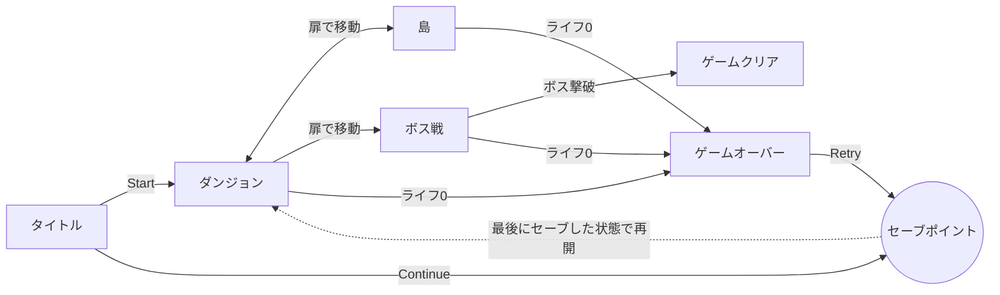
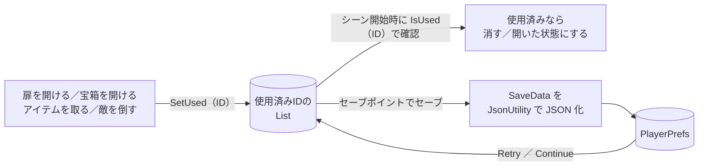

<!--
  ★ 公開前にやること（このコメントはGitHub上では表示されません）
  1. docs/images/ フォルダを作り、title.png・gameplay.gif などを置く
  2. 「（要記入）」と書かれた箇所を自分の情報に書き換える
  3. 書き終わったらこのコメントは消してOK
-->

<h1 align="center">🏝️ Island Adventure</h1>

<p align="center">
  島とダンジョンを冒険し、カギで扉を開けながらボスを目指す<b>見下ろし型2Dアクションゲーム</b>
</p>

<p align="center">
  
  
  
  
</p>

<p align="center">
  
</p>

## 目次

- [概要](#概要)
- [スクリーンショット](#スクリーンショット)
- [遊び方](#遊び方)
- [主な機能](#主な機能)
- [技術的なポイント](#技術的なポイント)
- [開発環境](#開発環境)
- [実行方法](#実行方法)
- [ディレクトリ構成](#ディレクトリ構成)
- [苦労した点と解決方法](#苦労した点と解決方法)
- [今後の改善予定](#今後の改善予定)
- [この制作で学んだこと](#この制作で学んだこと)
- [使用素材・クレジット](#使用素材クレジット)

## 概要

職業訓練のUnity授業で制作した、見下ろし型（トップビュー）の2Dアクションゲームです。
教材書籍のサンプルをベースに、**セーブ／ロード機能・剣による近接攻撃・サウンド管理などを独自に設計して追加**しました。

| 項目 | 内容 |
| --- | --- |
| ジャンル | 見下ろし型2Dアクション・アドベンチャー |
| 制作期間 | 2026年10月〜（約2週間・授業内） |
| 制作人数 | 職業訓練の授業内で、講師・受講生と共同制作 |
| 担当範囲 | （要記入：例「プレイヤー操作、セーブ機能、UI」など自分が書いた部分） |
| 使用言語 | C# |
| 対応プラットフォーム | Windows（キーボード／ゲームパッド対応） |

> [!NOTE]
> 教材をなぞるだけでなく、「シーンをまたいでも開けた扉が開いたままになる」「死んだらセーブした状態から再開できる」など、
> 実際のゲームで当たり前に求められる仕様を**自分たちで考えて実装**したことが、このプロジェクトのいちばんの見どころです。

## スクリーンショット

| タイトル画面 | 島エリア |
| :---: | :---: |
|  |  |
| **ダンジョン（ライト演出）** | **ボス戦** |
|  |  |

## 遊び方

島とダンジョンを探索し、宝箱から手に入れた**カギ**で扉を開けながら進みます。
ボスを倒すとゲームクリアです。セーブポイントでセーブしておけば、やられてもそこから再開できます。

### 操作方法

| 操作 | キーボード | ゲームパッド |
| --- | --- | --- |
| 移動 | `W` `A` `S` `D` ／ 矢印キー | 左スティック ／ 十字キー |
| 弓を撃つ（**長押しでチャージ**） | `Enter` | 西ボタン（Xbox: X ／ PS: □） |
| 剣で斬る | `Space` | 南ボタン（Xbox: A ／ PS: ×） |
| セーブ（セーブポイント上で） | `E` | 東ボタン（Xbox: B ／ PS: ○） |
| メニュー選択・決定 | 矢印キー ＋ `Enter` | 十字キー ＋ 決定ボタン |

### ゲームの流れ



## 主な機能

- **アクション**
  - 8方向移動と、向きに合わせたキャラクターアニメーション
  - 弓：ボタン長押しでチャージし、溜め切ると**攻撃力2倍**（溜め具合をゲージと弓の変形で表示）
  - 剣：近接攻撃と斬撃エフェクト
- **探索**
  - 宝箱からアイテム（カギ・矢・回復）が出現
  - カギを消費して扉を開ける
  - 扉（Exit）の番号でシーン間を移動し、入った扉の前に出現
  - ダンジョンでは、プレイヤーの向きに合わせて回転するライトで暗闇を照らす
- **敵・ボス**
  - プレイヤーが近づくと追いかけてくる敵
  - プレイヤーに向けて弾を撃つボス
- **セーブ／ロード**
  - 開けた扉・開けた宝箱・取ったアイテム・倒した敵を記録し、**シーンを移動しても状態を保持**
  - セーブポイントでセーブし、ゲームオーバー時の Retry やタイトルの Continue で**最後にセーブした状態から再開**
  - セーブデータがないときは Continue ボタンを押せないように制御
- **UI・サウンド**
  - ライフ・チャージゲージ・矢とカギの所持数を表示
  - キーボード／ゲームパッドで操作できるゲームオーバー・タイトル画面
  - シーンに応じたBGMの切り替えと効果音（AudioMixerで音量を管理）

## 技術的なポイント

### 1. セーブ／ロードの仕組み（独自設計）

「どのオブジェクトをもう使ったか」を**IDのリスト**で管理し、セーブ時に **JSON に変換して PlayerPrefs に保存**しています。



- **IDの自動生成**：`シーン名_タグ_座標` からIDを作るので、オブジェクトを置くたびにインスペクターで番号を振る必要がありません。
- **シーンをまたいで保持**：使用済みIDのリストを `static` にして、シーンを読み込み直しても消えないようにしています。
- **宝箱の中身の扱い**：宝箱から出たアイテムには「宝箱のID ＋ `_Item`」というIDを付けています。宝箱を開けたまま中身を取らずに部屋を出ても、戻ったときにもう一度出てきます。
- **セーブ内容をクラスにまとめる**：`[System.Serializable]` の `SaveData` クラスに、使用済みID・シーン名・セーブ位置・所持数をまとめ、`JsonUtility` で1つの文字列にしています。

```csharp
// SaveDataManager.cs（抜粋）
public static void Save(Vector3 savePointPos)
{
    SaveData data = new SaveData();
    data.usedIds = new List<string>(_usedIds);
    data.sceneName = SceneManager.GetActiveScene().name;
    data.savePointPosition = savePointPos;
    data.keys = ItemKeeper.hasKeys;
    data.arrows = ItemKeeper.hasArrows;

    string json = JsonUtility.ToJson(data);     // SaveData → JSON文字列
    PlayerPrefs.SetString(KEY_SAVE_DATA, json);
    PlayerPrefs.Save();
}
```

### 2. Input System によるチャージ攻撃と操作の切り替え

- 攻撃アクションに **Hold インタラクション**を設定し、`GetTimeoutCompletionPercentage()` で長押しの進み具合（0〜1）を取得しています。その値を弓の変形・ゲージ・攻撃力に反映しています。
- ゲームオーバーやゲームクリアのときは、アクションマップを **Player から UI に切り替え**て、キャラクター操作を止めてメニュー操作だけを受け付けます。
- セーブは攻撃キーと重ならない**専用の Save アクション**を用意し、セーブポイントに触れている間だけ受け付けます。

### 3. ゲーム全体の管理

- **状態管理**：`GameState`（InGame／GameOver／GameClear／GameEnd）で、ゲームの状態に応じてプレイヤーや敵の処理を止めています。
- **シーン移動**：扉ごとに番号と向きを持たせ、移動先のシーンで同じ番号の扉の前にプレイヤーを配置しています。
- **サウンド**：`SoundManager` を `DontDestroyOnLoad` で1つだけ残す**シングルトン**にして、シーンをまたいでもBGMが途切れないようにしています。

## 開発環境

| 種類 | 名前・バージョン |
| --- | --- |
| ゲームエンジン | Unity 6000.3.24f1（Unity 6） |
| 言語 | C# |
| レンダリング | Universal Render Pipeline 17.3.0（2D Light を使用） |
| 入力 | Input System 1.20.0 |
| 主なパッケージ | 2D Tilemap、2D Animation、Unity UI、TextMesh Pro |
| エディタ | Visual Studio |
| バージョン管理 | Git ／ GitHub |

## 実行方法

> [!IMPORTANT]
> **Unity 6000.3.24f1** で開いてください。違うバージョンで開くと、変換が走ったり正しく動かなかったりすることがあります。

1. このリポジトリをクローンします。
   ```bash
   git clone https://github.com/Dyna-Rise/IslandAdventure.git
   ```
2. Unity Hub の **「追加」→「ディスクから加える」** で、クローンしたフォルダを選びます。
3. プロジェクトを開いたら、`Assets/Scenes/Title.unity` を開いて再生ボタンを押します。

<details>
<summary>セーブデータを消したいとき</summary>

Unity エディタのメニュー **Edit → Clear All PlayerPrefs** で削除できます。
タイトル画面の Continue ボタンが押せなくなれば削除できています。

</details>

## ディレクトリ構成

```text
Assets/
├── Scenes/            # Title / DungeonMap / Island1 / BossStage
├── Scripts/
│   ├── Player/        # 移動・攻撃・アイテム所持・ライト・カメラ
│   ├── Enemy/         # 敵の追跡とダメージ処理
│   ├── Boss/          # ボスの攻撃と弾
│   ├── SaveData.cs         # セーブする内容をまとめたクラス
│   ├── SaveDataManager.cs  # セーブ／ロードとIDの管理
│   ├── SavePoint.cs        # セーブポイント
│   ├── RoomManager.cs      # シーン移動時のプレイヤー配置・BGM切り替え
│   ├── SoundManager.cs     # BGM・効果音の管理
│   └── UIController.cs     # ライフ・ゲージ・所持数・ゲームオーバー画面
├── Prefabs/           # Player、Enemy、Door、ItemBox、SavePoint など
├── Settings/          # Input Actions、URP の設定
└── Sounds/            # BGM・効果音
```

## 苦労した点と解決方法

| 困ったこと | 原因 | 解決方法 |
| --- | --- | --- |
| ゲームオーバー画面で、Retry と Quit のどちらも選ばれていない状態になる | ライフやチャージゲージの **Slider も「選択できるUI」** だったので、キー操作で選択が移っていた | Slider の **Navigation を None** にして、ボタンだけを選べるようにした |
| セーブポイントでセーブキーを押すと、同時に攻撃も出てしまう | セーブ（Submit）と攻撃に、同じ Enter／Space キーが割り当てられていた | Player マップに**セーブ専用の Save アクション**（`E`／東ボタン）を追加した |
| Retry 後にシーンを移動すると、扉の前ではなくおかしな位置に出る | 「セーブポイントから始める」フラグが `static` のため、次のシーンにも残っていた | フラグを使ったらすぐ `false` に戻し、**1回きりの合図**として扱うようにした |
| 弓を長押ししてもチャージされない | 攻撃アクションに **Hold インタラクション**が設定されていなかった | Input Actions で Attack に Hold を追加した |

## 今後の改善予定

- [ ] 敵とボスに共通する処理を親クラスにまとめる（継承でコードの重複を減らす）
- [ ] セーブ先を PlayerPrefs から **JSON ファイル**（`Application.persistentDataPath`）に変更する
- [ ] セーブしたときに画面にメッセージを表示する
- [ ] 音量設定画面を追加する
- [ ] ビルド版を配布する（GitHub Releases ／ unityroom）

## この制作で学んだこと

- Unity の基本（GameObject・コンポーネント・プレハブ・シーン）と、C# でゲームの仕組みを組み立てる方法
- `static` 変数で、シーンをまたいでデータを持ち回る方法と、その注意点
- `List` と `JsonUtility` を使った**データの保存と復元**
- Input System の**アクションマップ・インタラクション**の使い分け
- うまく動かないときに、**インスペクターの設定とコードの両方から原因を切り分ける**考え方
- Git でこまめにコミットし、作業の区切りを記録すること

## 使用素材・クレジット

| 素材 | 作者・配布元 | 用途 |
| --- | --- | --- |
| Pixel Adventure 1 | Pixel Frog（Unity Asset Store） | （要記入） |
| Sunny Land | ansimuz（Unity Asset Store） | （要記入） |
| 教材書籍の付属素材 | （要記入：書籍名・出版社） | キャラクター・タイルマップ・UI画像 |
| BGM・効果音 | （要記入：配布サイト名） | BGM・効果音 |

各素材の著作権は、それぞれの作者に帰属します。

---

<p align="center">
  制作：（要記入：名前 または GitHub ID） ／ 職業訓練 Unityゲーム開発コース
</p>
